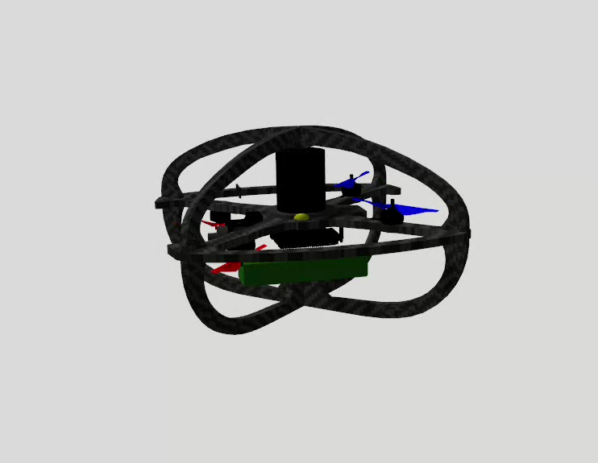
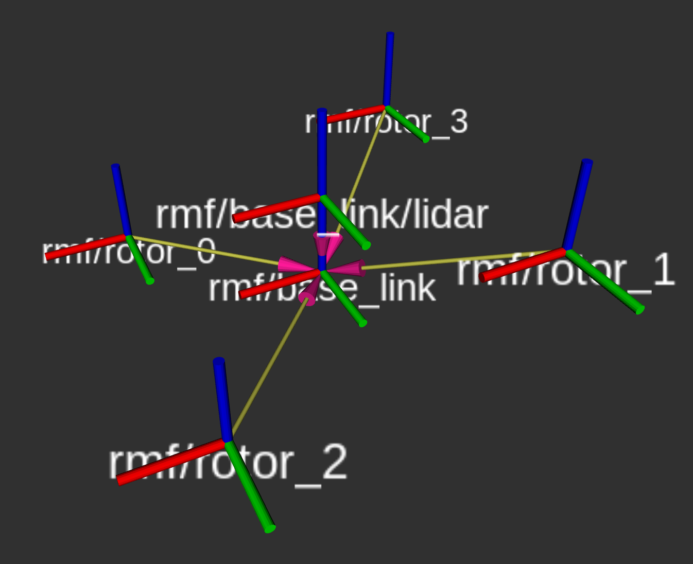
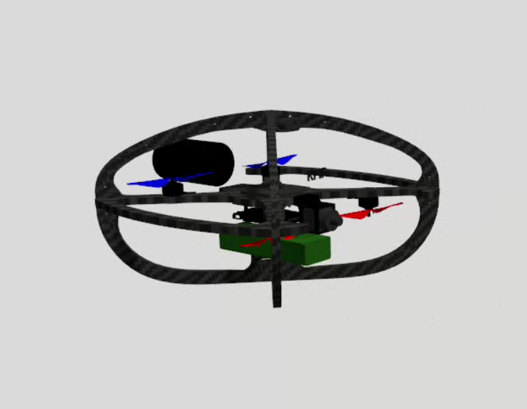
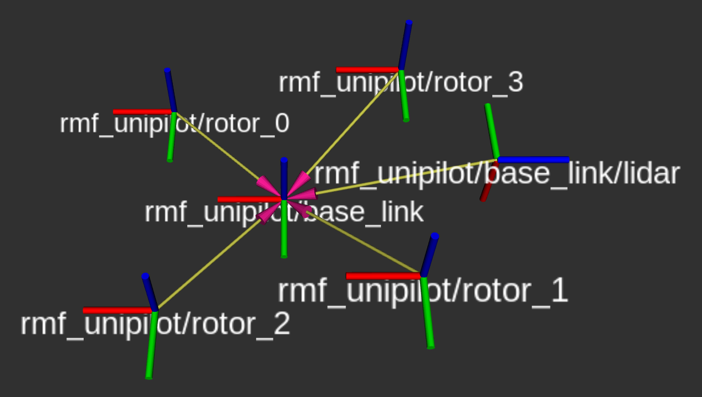
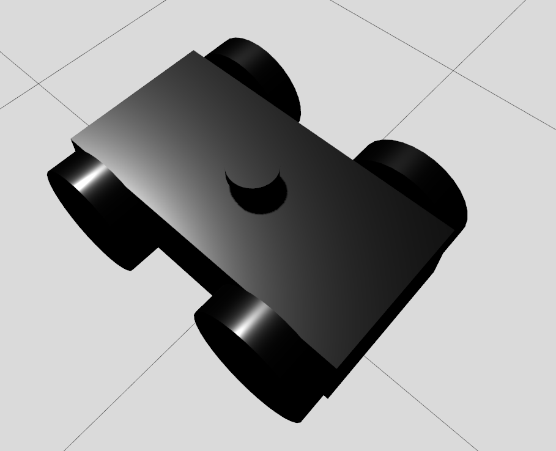

# Simulation

The Simulation environment utilizes **Gazebo** and **Aerial Gym Simulator**. Gazebo is used to test and validate the complete autonomy stack in realistic 3D environments, while Aerial Gym Simulator provides a massively parallelized environment for training data-driven and learning-based methods.

## Gazebo

We provide ROS 2 simulators for multi-rotor and differntial drive wheeled robot integrated with the Unified Autonomy Stack. Both simulators are located in the `unified_autonomy_stack/workspaces/ws_sim` workspace.

### Launch individual scenes from Make

Use `launch-sim` to run the normal Unipilot simulation, GBPlanner, NMPC, ROS bridge,
agent and ROS 1 RViz in any of the three local scene collections. This does not run
the benchmark, assign a task, start the agent, or perform takeoff automatically.
Docker images and the simulation/agent workspaces must already be built. The
scene selector uses host Python 3 and PyYAML (`python3-yaml`).

```bash
# Open-RMF scenes in gz_sim_worlds; saved XYZ/yaw presets are used.
make launch-sim COLLECTION=gz_sim_worlds SCENE=rmf_office
make launch-sim COLLECTION=gz_sim_worlds SCENE=rmf_hotel
make launch-sim COLLECTION=gz_sim_worlds SCENE=rmf_airport_terminal

# SubT cave scene with the existing default spawn.
make launch-sim COLLECTION=subt_cave_sim SCENE=darpa_cave_01

# An already converted HM3D validation scene; use its saved import spawn.
make launch-sim COLLECTION=hm3d SCENE=00800-TEEsavR23oF

# Available filenames/scene IDs and a preview without launching Docker.
make list-scenes
make launch-sim-dry-run COLLECTION=gz_sim_worlds SCENE=rmf_hotel

# Stop before switching scenes. Assets and model caches are retained.
make stop-sim
```

`SCENE` is an HM3D directory ID, or the filename/stem of a world under the selected
package's `worlds/` directory. Exact filenames, including `.world` or `.sdf`, are
accepted. The selector reads the internal Gazebo world name from the SDF so robot
spawning, sensor bridges and TF agree; you do not need to supply `world_name`.
Gazebo and SubT spawn presets are stored in
[`robot_bringup/config/simulation/scene_spawns.yaml`](../workspaces/robot_bringup/config/simulation/scene_spawns.yaml).
Entries are grouped by collection and keyed by exact world filename, with values
`[x, y, z, yaw]`. Edit this file to change a saved spawn or add another world.
HM3D spawns remain in each converted scene's JSON metadata under
`generated/hm3d/worlds/` (or `HM3D_ASSETS/worlds/`). The selector does not read the
benchmark configuration or apply benchmark tasks, timing, ROI or planning bounds.

`physics_step_sec` in the same config defaults to **0.001 s**, matching the UAV
motor/controller integration used in evaluation. Some source worlds, including
the hotel, use a 10 ms step that destabilizes the UAV. The launcher writes a
prepared copy under `generated/simulation/worlds/<collection>/` and mounts it
read-only into Gazebo; source dataset worlds are unchanged. Spawn roll and pitch
are explicitly zero, with yaw taken from the preset or `SPAWN` override.

For a world without a saved spawn, provide a known free-space spawn explicitly:

```bash
make launch-sim COLLECTION=gz_sim_worlds SCENE=rmf_clinic SPAWN="X Y Z YAW"
```

Replace all four placeholders with numbers. XYZ are **world-frame metres**, yaw
is **radians**. `SPAWN` can override a saved spawn for any collection. Office/hotel/
airport presets, the standard cave preset and imported HM3D spawns are available;
other scenes do not have automatic free-space discovery. Use `launch-sim-dry-run`
to inspect the resolved command before starting.

Optional arguments:

```bash
# Add Jazzy Hydra and its existing sensor transport to the selected scene.
make launch-sim COLLECTION=gz_sim_worlds SCENE=rmf_hotel WITH_SCENE_GRAPH=true

# Use another directory of converted HM3D assets, mounted read-only.
make launch-sim COLLECTION=hm3d SCENE=00800-TEEsavR23oF HM3D_ASSETS=/path/to/converted/hm3d

# Run Compose in the background; stop with make stop-sim.
make launch-sim COLLECTION=gz_sim_worlds SCENE=rmf_office DOCKER_ARGS=-d
```

Enter a task in the ROS 1 GBPlanner panel's **Agent task** text box and click
**Send Task**. After the panel confirms reception, click **Start Agent** to begin.
Submitting a new task while the agent is running replaces its current task;
submitting to an idle agent leaves it waiting for Start. **Stop Agent** stops
reasoning and the planner. Task text uses the `/agentic_uas/task` topic bridge,
while Start/Stop use the existing bridged services.

Attach with `make attach-agentic_uas` when using terminal services instead.
Initialize the robot manually as usual. Match agent `goal_bounds` to GBPlanner's global bounds
if customizing them for the selected scene. HM3D must be converted first; see
[HM3D conversion and sensor instructions](hm3d_simulation.md).

### Existing Unipilot world presets

One Compose file supports both environments, with the office as the default:

```bash
make launch DOCKER_COMPOSE_FILE=docker-compose.uav_nmpc_unipilot_sim.yml SIM_WORLD_PROFILE=office
make launch DOCKER_COMPOSE_FILE=docker-compose.uav_nmpc_unipilot_sim.yml SIM_WORLD_PROFILE=subt
```

Stop the current simulation before switching presets:

```bash
make stop DOCKER_COMPOSE_FILE=docker-compose.uav_nmpc_unipilot_sim.yml
```

`office` loads
`gz_sim_worlds/rmf_office.sdf` (Gazebo world `cosmos`) at `(10, -3, 0.5)`;
`subt` loads `subt_cave_sim/darpa_cave_01.sdf` (world `map`) at `(40, 5, 0.5)`.
Both expose the same ROS sensor topics, TF frames, controller, and ROS 1 bridge.
The world filename and internal Gazebo world name are separate launch arguments.
For worlds named differently from `map`, an identity transform connects the
Gazebo pose tree to the stack's `map` frame.
Both worlds use a 1 ms physics step for the UAV motor and acceleration controllers.
The launch repeats the complete static TF set once per simulated second because
the bundled legacy bridge uses a volatile ROS 2 subscriber. This lets ROS 1
consumers obtain camera extrinsics and the map-to-odometry transform even when
the bridge or RViz starts late. The bridge's ROS 2 static TF publisher uses
transient-local durability.
After updating world resources or bringup scripts, run `make build-sim` once.

### Multirotor Simulator

The [multirotor simulator](https://github.com/ntnu-arl/rmf_gz/tree/dev/unified_autonomy_stack) consists of the ROS 2 package `unified_autonomy_stack/workspaces/ws_sim/src/rmf_gz`.
The simulator provides two robots each carrying a color camera, a depth camera, and a LiDAR sensor. The difference is in the type of lidar onboard the robot.
For both robots, the following sensors and control options are setup. `<ns>` referes to the namespace for that robot.

Sensors:

| Sensor                        | Topic              | Data type                     | Rate (Hz) |
| ----------------------------- | ------------------ | ------------------------      | -- |
| Color camera                  | `/<ns>/cam/rgb`     | `sensor_msgs/msg/Image`       | 10 |
| Depth camera (Image)          |`/<ns>/cam/depth`    | `sensor_msgs/msg/Image`       | 30 |
| Depth camera (Point Cloud)    | `/<ns>/cam/pc`      | `sensor_msgs/msg/PointCloud2` | 30 |
| LiDAR                         |`/<ns>/lidar/points` | `sensor_msgs/msg/PointCloud2` | 10 |

Control Options

| Command Type  | Topic | Data type |
| ------------- | ----- | --------- |
| Velocity      | `/<ns>/cmd/vel` | `geometry_msgs/msg/Twist` |
| Acceleration  | `/<ns>/cmd/vel` | `geometry_msgs/msg/Twist` |

#### Sensor configuration 1: Traditional LiDAR

Robot namespace (`<ns>`): `rmf`



LiDAR configuration:

- Field of View: `360 x 90 deg`
- Orientation: 


#### Sensor configuration 2: Dome LiDAR

Robot namespace (`<ns>`): `rmf_unipilot`



LiDAR configuration:

- Field of View: Dome `360 x 90 deg`
- Orientation: 


### Wheeled Robot Simulator

The [wheeled robot simulator](https://github.com/ntnu-arl/ugv_gz/tree/dev/unified_autonomy_stack) consists of the ROS 2 package `unified_autonomy_stack/workspaces/ws_sim/src/ugv_gz`.
The simulator provides a differential drive wheeled robot carrying a color camera, a depth camera, and a LiDAR sensor. 



The following sensors and control options are setup.

Sensors:

| Sensor                        | Topic              | Data type                     | Rate (Hz) |
| ----------------------------- | ------------------ | ------------------------      | -- |
| Color camera                  | `smb_arl/cam/rgb`     | `sensor_msgs/msg/Image`       | 10 |
| Depth camera (Image)          |`smb_arl/cam/depth`    | `sensor_msgs/msg/Image`       | 30 |
| Depth camera (Point Cloud)    | `smb_arl/cam/pc`      | `sensor_msgs/msg/PointCloud2` | 30 |
| LiDAR                         |`smb_arl/lidar/points` | `sensor_msgs/msg/PointCloud2` | 10 |

Control Options

| Command Type  | Topic | Data type |
| ------------- | ----- | --------- |
| Velocity      | `smb_arl/cmd/vel` | `geometry_msgs/msg/Twist` |

## Aerial Gym Simulator

The [Aerial Gym Simulator](https://github.com/ntnu-arl/aerial_gym_simulator) is an open-source simulator for massively parallelized simulation of multirotor platforms.

<iframe width="560" height="315" src="https://www.youtube.com/embed/VBVBQNtHZoc?si=fKTiwZZlOuz0k59U" title="YouTube video player" frameborder="0" allow="accelerometer; autoplay; clipboard-write; encrypted-media; gyroscope; picture-in-picture; web-share" referrerpolicy="strict-origin-when-cross-origin" allowfullscreen></iframe>

To train policies for the autonomy stack, a dedicated training task description is set up within the simulator and can be found [here]. This includes the environment setup, reward formulation, obstacle management and episode management. The training task uses a simulated quadrotor platform with a dome LiDAR sensor placed, facing backwards.
